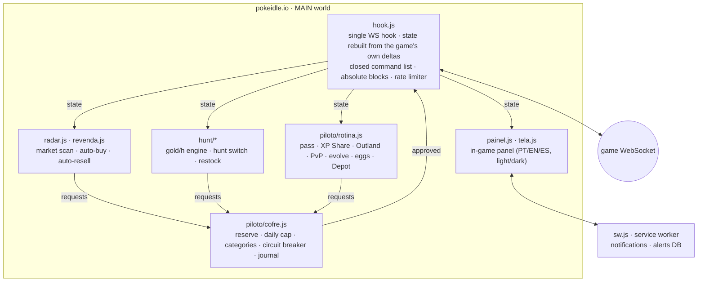

<div align="center">


# PokeIdle Piloto

**An autopilot for [pokeidle.io](https://pokeidle.io) with a budget vault in front of every gold coin it spends.**
Market radar, hunt optimizer and daily routine in one Chrome extension, built so it can't touch premium currency.


</div>

---

## What it does

Everything lives inside the game, behind a **Piloto** bar above your active Pokémon, with a single **Off · Manual · Automatic** switch.

- **Market radar.** Scans the community market, flags items and Pokémon priced well below their recent sales, and can buy them automatically in gold. Bought items can be **resold automatically**: one action every 10 min (list or lower the price), never below cost + 15%.
- **Hunt optimizer.** Ranks hunting spots by real gold/hour, switches hunts, restocks potions and revives at the buy price, within the budget.
- **Daily routine (free actions):** battle pass claims, XP Share (puts the furthest-behind team members in empty slots), highest unlocked Outland tier, training rotation and a PvP team made of your 5 strongest by Power, without reshuffling over tiny differences.
- **Irreversible actions are opt-in:** evolving (never shiny, Outland or Mega), hatching eggs you own, and clearing the Depot. Before selling the Depot it first moves your PvP team, shinies and top-potential Pokémon into the Collection.

## The vault (`cofre`): the part I'm proudest of

An automation that spends in-game money needs hard limits more than features. Every gold purchase goes through the vault:

- **Reserve:** never goes below max(5M, 2 h of measured gold/h).
- **Daily cap:** 50% of gold/h × 24 h (a fixed 2M until there's a measurement), reset at 00:00 Brasília time, plus per-category caps (restock, market, eggs; eggs start **forbidden**).
- **Unknown price = no purchase.** Gold already committed to pending orders counts against the reserve, so back-to-back orders can't break through it.
- **Circuit breaker:** 3 server refusals in a row turn that module off (auto re-arms after 30 min).
- **A journal** of every action, readable in the panel.

And under the vault, the WebSocket hook itself enforces:

- **Closed command list.** The pilot can send only 17 game commands, each validated against the game's own format. Anything else is dropped.
- **Absolute block on 20 commands:** gem withdrawal, diamond shop, VIP pass, guild donation, sending coins or trades, chat and DMs, and guild or Pokémon-level changes. Purchases only in `gold`; a gem purchase is refused at the hook.
- **Hardened against the page:** the allow-list only accepts own keys (`Object.hasOwn`), requests are copied and frozen, and the command type and block list are checked again right before sending. Tests try to swap the vault, forge state and rewrite the send function from the page, and they fail.
- **One rate limiter for everything:** reads ~2/s, writes 1/s with a burst of 3.

## Architecture



No build step: plain JavaScript modules, Manifest V3.

## Install

1. Download or clone this repo.
2. Open `chrome://extensions` and turn on **Developer mode**.
3. Click **Load unpacked** and pick the `extension/` folder.
4. Open the game. Everything starts **off**. Suggested order: check the reserve in the Vault tab → Routine (pass and XP Share cost nothing) → Automation (hunt and restock) → Radar options (buying and reselling).

Use a single game tab: each tab has its own vault.

## Tests

```bash
node tests/teste-piloto.mjs   # Node 22+: runs the MAIN-world scripts in a fake browser with a simulated WebSocket
node tests/e2e.mjs            # needs Playwright: loads the real extension in Chromium against a fake pokeidle.io (tests/fake)
```

`teste-piloto.mjs` covers state rebuilding, real-money command blocks, the closed list, vault rules (unknown price, reserve, daily cap, committed gold), the rate limiter, page-side attacks, the circuit breaker, the routine commands and the Depot rules: **16/16 passing**.

## Credits

Built on top of **Radar do Mercado** and **/hunt**, two extensions by **Allan Hert**, used and published with his permission. PokeIdle Piloto merges both into a single hook and adds the vault, the routine, auto-resell and the safety layer.

## Disclaimer

Fan-made personal project, not affiliated with pokeidle.io. Automating a game may go against its Terms of Service. Use it on your own account and at your own risk. Pokémon is a trademark of Nintendo / Creatures / GAME FREAK.

## License

Copyright © 2026 André Miller Fleck (Dreds) and Allan Hert. All rights reserved: the source is public for reading, not licensed for reuse.
