<div align="center">


# PokeIdle Piloto

**An autopilot for [pokeidle.io](https://pokeidle.io) with a budget vault in front of every gold coin it spends.**
Hunt optimizer, market radar, team manager and daily routine in one browser extension for Chrome, Edge, Brave, Opera GX and Firefox 140+, built so it can't touch premium currency.


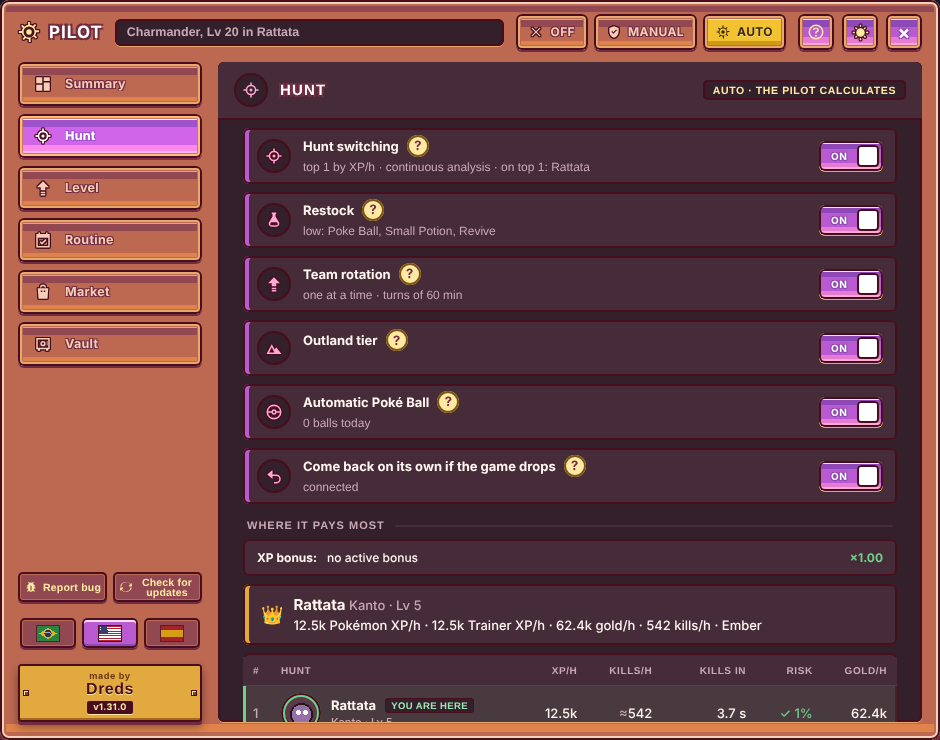

</div>

---

## What it is

Everything lives inside the game, behind a **Pilot** bar above your active Pokémon, in a window built from the game's own pieces (frame, menu, rows, ON/OFF switches). One switch runs it all:

- **Off:** nothing automatic runs.
- **Manual:** you turn on and tune each automation yourself. Every row shows its settings (restock amounts, turn length, vault caps, the Radar's discounts and limits…) and the Radar starts by only alerting; its automatic buying stays off until you turn it on.
- **Automatic:** turns on the hunt switch, restock, the daily routine, the team builder, the rotation and the market radar, each with its own ON/OFF switch and no numbers to tune. A switch you turn off stays off after a reload. Irreversible actions (evolving, hatching) stay off until you turn them on.

<p align="center">
  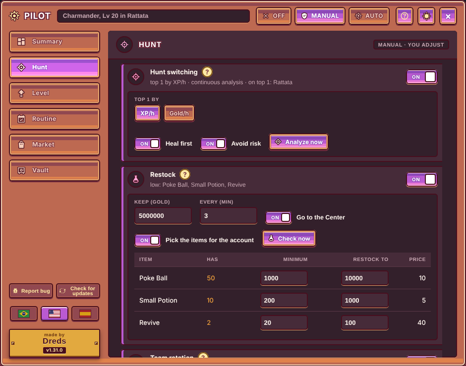
</p>

## Features

<p align="center">
  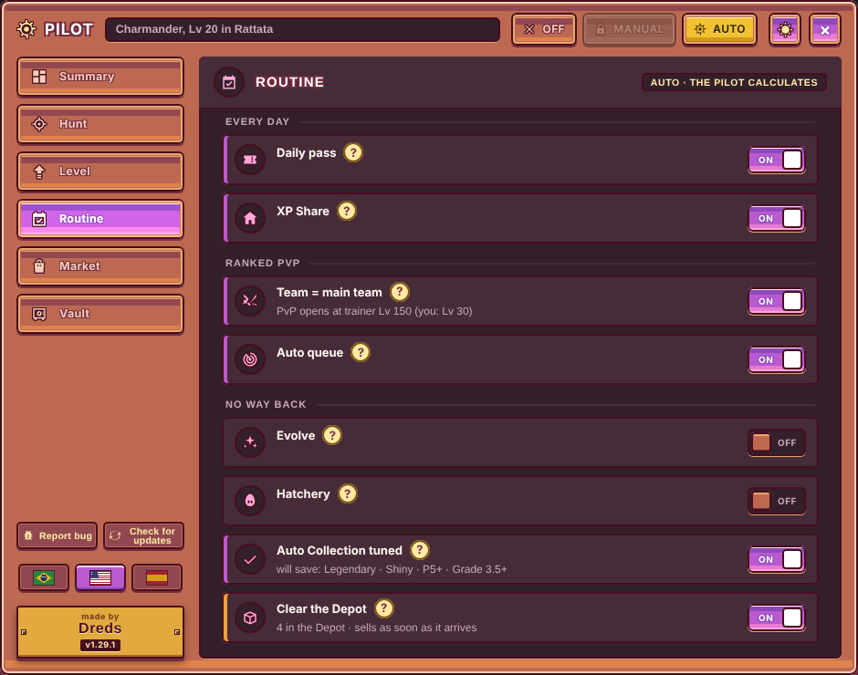
  
  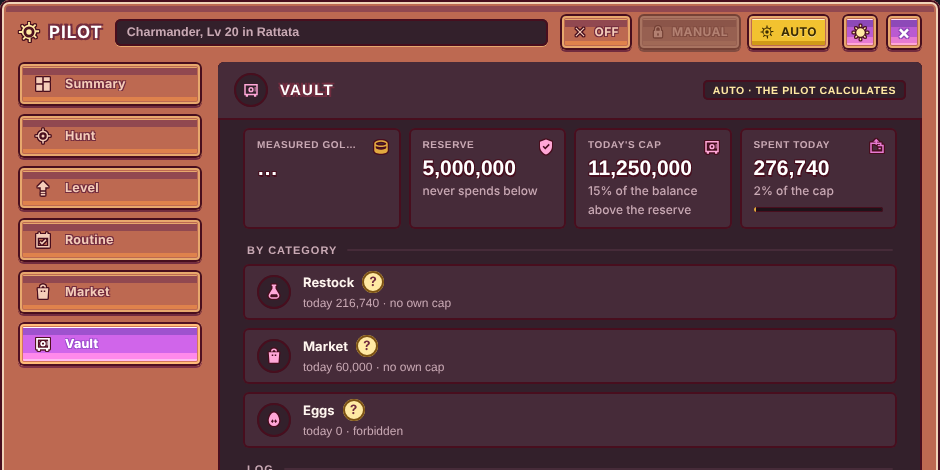
</p>

**Hunting**
- **Hunt switching.** Ranks every hunt for the Pokémon in the field by XP/h or gold/h (the /hunt model plus what you actually measured there) and always goes to the top one, waiting for a gap in combat. Gold/h already takes the potions you'd burn off, trainer XP/h takes off the 10% of a level each faint costs, and a hunt where your Pokémon would faint before finishing a single kill is left out, and with **Avoid risk** (on by default) risky hunts are listed after the safe ones.
- **Restock.** Buys the balls, potions and revives ticked in the game's own automation, at the shop price and within the vault. With **Pick the items for the account** (on in Auto) it keeps exactly one ball, one potion and one revive ticked there and switches them as the account grows: the potion by your team's HP, the revive by cost and the ball by your gold/h and balance (a rich account keeps the Ultra Ball even while leveling a weak Pokémon), so restock only buys those three. The potion is the one with the lowest gold per HP it actually heals (healing past full HP is waste), and the amounts come from what your account really uses: the minimum is 1 hour of use and the target 6 hours, measured from your inventory. A new account gets its items ticked right away and buys the first batch as soon as it has gold (restock keeps only 10% of the balance; the rest of the vault keeps the full reserve). With little gold it brings revives and potions to their minimum before any Poké Ball. Every Center trip heals, and a watchdog brings you back to your hunt if the character is left standing at the Center.
- **Pokémon Center queue.** Two buttons next to the game's "Go to Pokémon Center": **Queue** presses the game's button at the first gap in combat; **Return** goes, heals and comes back to the same hunt. It never presses "Give up the fight".
- **Automatic Poké Ball for accounts without VIP.** One gold ball at each fainted wild Pokémon, never faster than the VIP auto-throw (1.3 s), shinies first, never Beast Ball. Locked while VIP is active. Note that the game treats auto-throwing as a VIP benefit.
- **Comes back by itself.** If the game stops in the tab for 5 minutes (another device took the session, the server restarted), the Piloto reloads the page, waiting while another tab of the same browser is playing.

**Team**

<p align="center">
  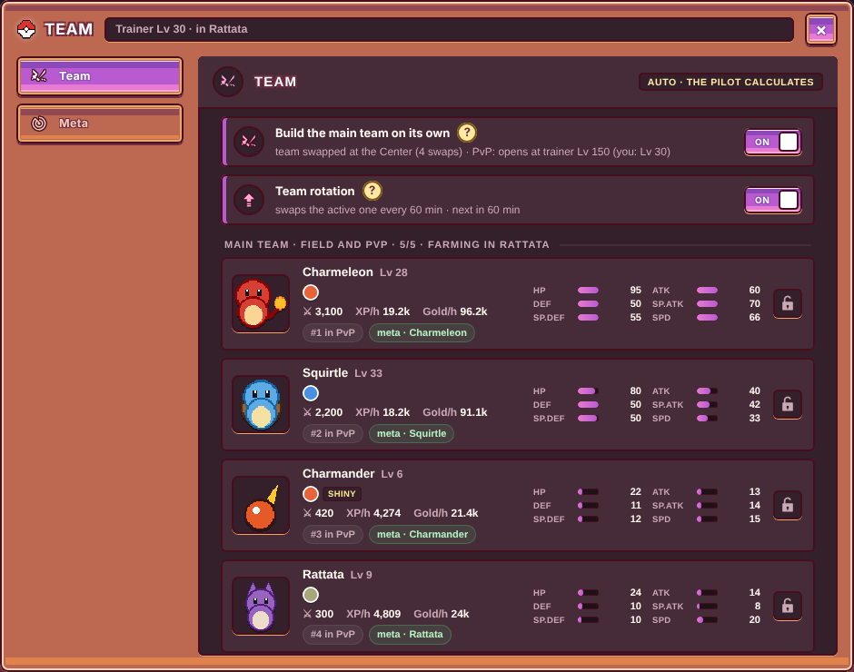
  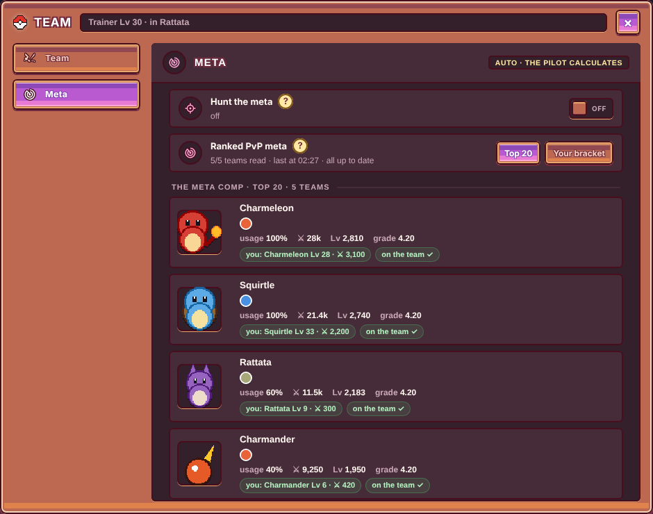
</p>

- **One team for the field and PvP.** The Team window builds it: your locked Pokémon first, then **the meta species you already own** (your best of each family; Megas count as their base form and a Pupitar counts for Tyranitar). Nothing outside the meta joins the team, so a new account doesn't fill it with weak catches, and the meta the team follows only changes after a species has been out of it for 24 hours (the 5th place of the ladder moves all the time). The same team goes to Ranked with the strongest opening. Team changes happen at the Pokémon Center: it pauses the hunt switch, heals, swaps everyone in the game's own order and goes back to the hunt.
- **Team rotation.** Each team member fights for one turn (60 min by default) and the one that has gone longest without fighting comes in next; a new cycle starts with the weakest and leaves the strongest for last. Hunt the meta pauses the rotation, which comes back together with hunt switching. With hunt switching on, the swap happens at the Center and the newcomer goes straight to its own best hunt.
- **Turn timer.** A ⏱ button on each row of the game's Team panel shows how long the active Pokémon has been fighting, the time left in its turn, the rotation queue with when each one comes in, and today's turns.
- **Days in the session clock.** The game's Session panel shows the hunt time in hours only (252:58:16); the Piloto splits it into a days box and the rest in hours (10 days · 12:58:16).
- **Meta tab.** Reads the Ranked ladder and the players' public profiles to show which species the top 20, or the players in your own bracket, are using, with daily ▲▼ changes and whether you own each one and have it on the team. When the meta shifts you get a small toast, never a pop-up.
- **Hunt the meta (opt-in).** Freezes the current meta comp, takes your strongest Pokémon to the regular hunt where those species spawn most (never Outland: Outland variants don't evolve), keeps the best catch of each family (including the ones you already had); it tries every team member as the hunter, and if no hunt is safe yet it waits, farming XP, until the trainer levels up — it never skips a species that spawns in a hunt; protects them from any sale, then hands the team to the builder and turns the hunt switch back on.
- **Evolution stones for the team.** When a team member is ready to evolve by stone and you don't have it, the Radar buys **one** from the market (cheapest listing that isn't yours), in gold and through the vault, and the opt-in evolve step uses it.

<p align="center">
  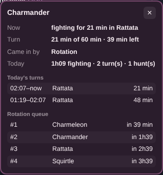
</p>

**Market**
- **Market radar.** Scans the community market, flags items and Pokémon priced well below their recent sales, and can buy them automatically in gold. Automatic buying follows your money, not a daily cap: it keeps buying what's profitable while the radar's unsold stock plus the new purchase stays under half of what you have (balance + that stock), and the room comes back as things sell.
- **Automatic resale.** Every 2 minutes it lists, lowers or raises one price, never below cost + 15%.
- **Automatic Pokémon listing.** Lists Pokémon you don't use at a price backed by 5+ similar sales, paying the market fee through the vault. Your team, locked and training Pokémon, held-item carriers, **shinies and legendaries are never listed**.
- **Deal alerts with the game's own art:** the Pokémon's animated sprite and the item icon at a crisp integer scale.

**Daily routine**
- **Tournaments.** Signs you up for every tournament as soon as registration opens (World and Amateur championships and the Showdown), waiting for the minimum level when there is one; it never cancels a registration.
- Battle pass claims, XP Share (the furthest-behind team members in empty slots), highest unlocked Outland tier, Ranked queue, Auto Collection kept on Legendary · Shiny · P5+ · the market's minimum grade, and Depot cleaning (it first moves your team, shinies and top-potential Pokémon into the Collection).
- **Tournaments.** Signs you up for every tournament as soon as registration opens: the monthly World (trainer Lv 300+) and Amateur (Lv 100+), and the weekly Showdown. Registration is free; it never cancels a registration and doesn't touch your team.
- **Irreversible actions are opt-in:** evolving (never shiny, Outland or Mega) and hatching eggs you own.

**Live bonus with Plateia**

<p align="center">
  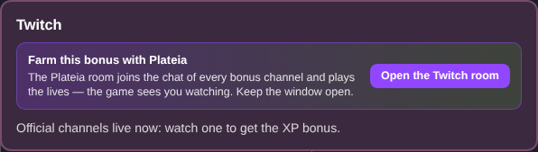
</p>

- If you also use [Plateia](https://github.com/DredsGG/plateia) (Twitch and Kick), opening the game opens its Twitch and/or Kick room in a separate window, once per browser session, for the platforms linked in your game account. If a room window is already open (even after the browser or the extension restarts or updates), it isn't opened again; only a missing one opens. The game's own Twitch/Kick bonus windows get an **Open the room** button, or a link to download Plateia if you don't have it.

**Support**

<p align="center">
  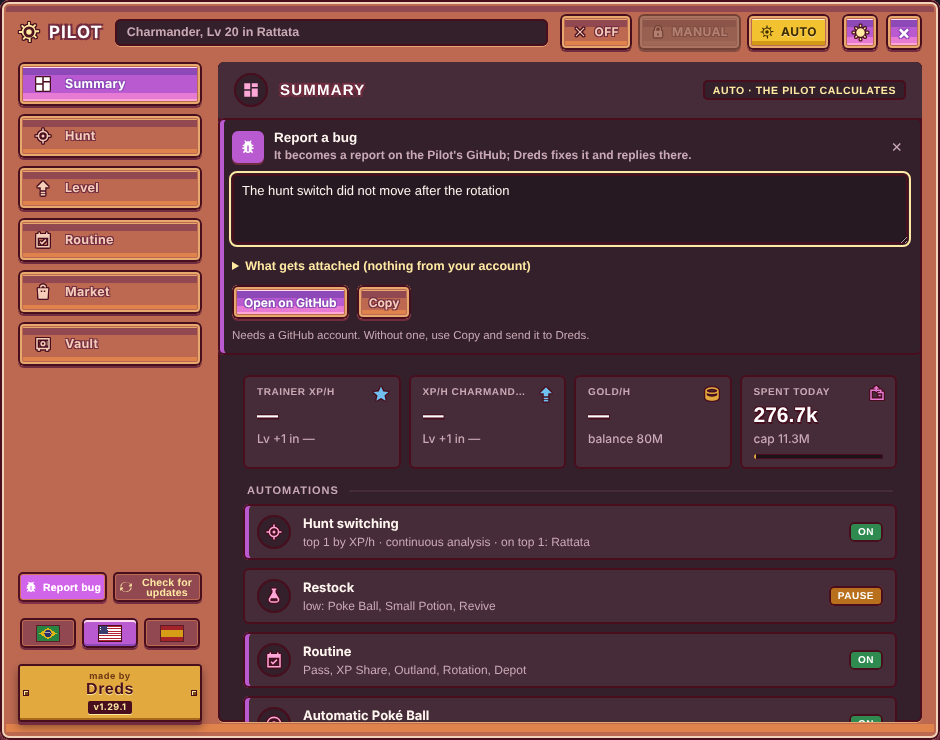
</p>

- **Plays nice with the server.** When the game answers "Devagar aí — muitas mensagens" (too many messages), the radar and the Pilot halve their pace on their own and speed back up slowly.
- **Report bug** opens a GitHub issue pre-filled with a privacy-safe report (versions, modes, health check, recent journal; no nick, no balance). **Check for updates** reads the latest release. Both sit at the bottom of the menu, above the "made by **Dreds** · vX.Y.Z" signature.
- **Update notice on the game page.** When a newer release exists, a small box in the middle of the game screen shows "New version vX.Y.Z", what changed in your language and an **Update** button that does the right thing for your browser. It comes back each time the game opens until you update; its X hides it until an even newer version. The first-run guide and the "What's new" box after an update show up the same way, without opening the Piloto. They never block the game or the automation and close with X or Esc. (Firefox installs from the signed .xpi update by themselves, so the version notice doesn't show there.)
- **Health check after every game update:** checks that the game modules and functions the Piloto relies on still exist, and reports what broke instead of failing silently.

## The vault (`cofre`): the part I'm proudest of

An automation that spends in-game money needs hard limits more than features. Every gold purchase goes through the vault:

- **Reserve:** never goes below max(5M, 2 h of measured gold/h).
- **Daily cap:** the larger of 50% of gold/h × 24 h (a fixed 10M until there's a measurement) and 15% of the balance above the reserve, reset at 00:00 Brasília time, plus per-category caps (restock, market, eggs; eggs start **forbidden**).
- **Unknown price = no purchase.** Gold already committed to pending orders counts against the reserve, so back-to-back orders can't break through it.
- **Circuit breaker:** 3 server refusals in a row turn that module off (auto re-arms after 30 min).
- **A journal** of every action, readable in the panel.

And under the vault, the WebSocket hook itself enforces:

- **Closed command list.** The pilot can send only 25 game commands, each validated against the game's own format. Anything else is dropped. The game's automation settings (`auto.set`) only accept two changes: turning on the Ranked auto-queue (VIP) and setting exactly one ball, one potion and one revive from the game's own catalog (never Beast or Master Ball); every other automation field is copied from the server's state, never from the request.
- **Absolute block on 20 commands:** gem withdrawal, diamond shop, VIP pass, guild donation, sending coins or trades, chat and DMs, and guild or Pokémon-level changes. Purchases only in `gold`; a gem purchase is refused at the hook.
- **Hardened against the page:** the allow-list only accepts own keys (`Object.hasOwn`), requests are copied and frozen, and the command type and block list are checked again right before sending. Tests try to swap the vault, forge state and rewrite the send function from the page, and they fail.
- **One rate limiter for everything:** reads ~2/s, writes 1/s with a burst of 3.

## Install

**Works on:** Chrome · Edge · Brave · Opera GX · Firefox 140+

Download the file from the [latest release](https://github.com/DredsGG/pokeidle-piloto/releases/latest): `pokeidle-piloto-vX.Y.Z.zip` for Chrome, Edge, Brave and Opera GX, and `pokeidle-piloto-vX.Y.Z.xpi` for Firefox. Then open the game: on a new install the Piloto starts in **Off** and shows a short guide. Check the reserve in the Vault tab, then pick **Manual** or **Auto**.

<p align="center">
  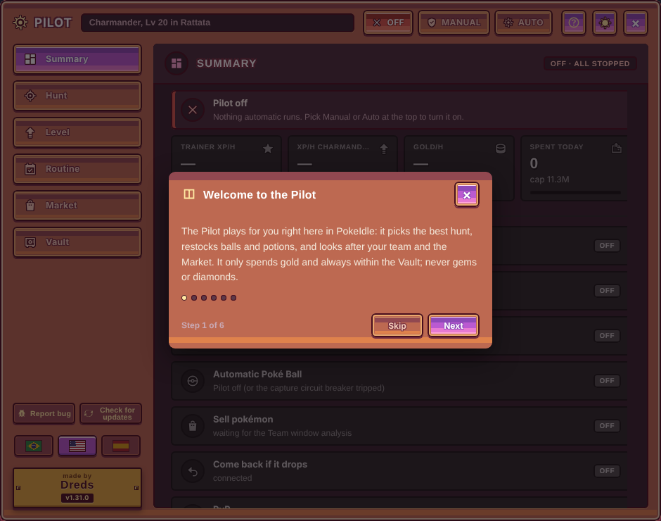
</p>

<details open>
<summary><b>Chrome</b></summary>

1. Download the `.zip` and unzip it into a folder you'll keep (not your Downloads, so it isn't deleted by accident).
2. Open `chrome://extensions` and turn on **Developer mode** (top right).
3. Click **Load unpacked** and choose the folder that has `manifest.json` inside.
4. To update: unzip the new version over the same folder, or use **Check for updates** in the Piloto's menu.
</details>

<details>
<summary><b>Microsoft Edge</b></summary>

1. Download the `.zip` and unzip it into a folder you'll keep.
2. Open `edge://extensions` and turn on **Developer mode** (left side).
3. Click **Load unpacked** and choose the folder that has `manifest.json` inside.
4. To update: unzip the new version over the same folder, or use **Check for updates** in the Piloto's menu.
</details>

<details>
<summary><b>Brave</b></summary>

1. Download the `.zip` and unzip it into a folder you'll keep.
2. Open `brave://extensions` and turn on **Developer mode** (top right).
3. Click **Load unpacked** and choose the folder that has `manifest.json` inside.
4. To update: unzip the new version over the same folder, or use **Check for updates** in the Piloto's menu.
</details>

<details>
<summary><b>Opera GX</b></summary>

1. Download the `.zip` and unzip it into a folder you'll keep, outside Opera's own profile folder.
2. Open `opera://extensions` and turn on **Developer mode** (top right).
3. Click **Load unpacked** and choose the folder that has `manifest.json` inside.
4. To update: unzip the new version over the same folder, or use **Check for updates** in the Piloto's menu.

If the Piloto disappears after you close Opera GX, just load it again the same way: it's a known Opera issue with unpacked extensions.
</details>

<details>
<summary><b>Firefox</b></summary>

1. Download the `.xpi` (signed by Mozilla) and open it, or go to `about:addons` → gear icon → **Install Add-on From File…** and pick it.
2. Confirm **Add**. Firefox updates the Piloto by itself from then on.
3. If Firefox ever shows the Piloto without access to pokeidle.io (the icon gets a red **!**), click the Piloto's icon and allow it.

Needs Firefox 140 or newer. If a release has no `.xpi` yet, the `.zip` can be loaded for the current session in `about:debugging` → **This Firefox** → **Load Temporary Add-on…**.
</details>

From a clone of this repo, load the `extension/` folder: it's the same code and the same manifest for every browser.

## Languages

Portuguese, English and Spanish. On first run the Piloto picks your browser's language (anything else falls back to English); switch any time with the PT · EN · ES buttons at the bottom of the menu. Light and dark themes.

## Known limitations

- **Firefox support is new:** the extension passes Mozilla's linter (`web-ext lint`) and runs the same code as Chrome, but it has had far less real use there. If something looks off, use **Report bug**.
- **Use a single game tab.** Each tab has its own vault, and opening the game somewhere else takes the session from this tab (it reloads by itself after 5 minutes).
- **PvP order:** the strongest Pokémon opens. The game hides the entry order of other players' teams, so the Piloto doesn't copy anyone's order.
- **Ranked PvP** opens at trainer level 150.
- The Plateia integration needs the [Plateia](https://github.com/DredsGG/plateia) extension installed in the same browser.
- Settings, turns and the journal live in this browser's storage; another browser or profile starts from scratch.

## Architecture

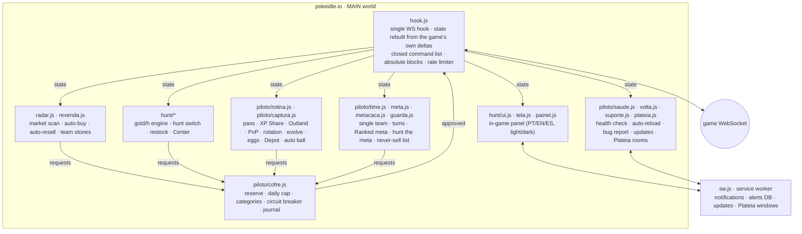

No build step: plain JavaScript modules, Manifest V3.

## Tests

```bash
node tests/teste-piloto.mjs   # Node 22+: the MAIN-world scripts in a fake browser with a simulated WebSocket (28/28)
node tests/teste-compra-pk.cjs && node tests/teste-vendapk.cjs   # Pokémon buy/list price rules
node tests/e2e.mjs            # needs Playwright: the real extension in Chromium against a fake pokeidle.io (tests/fake)
node tests/time.mjs           # team builder, Center swaps, rotation by turn, turn timer in the Team panel
node tests/meta.mjs           # Ranked meta from the ladder and profiles; profile pop-ups stay hidden
node tests/metacaca.mjs       # hunt the meta: picks the hunt, keeps the catch, fills the team
node tests/outland-meta.mjs   # Outland variants don't count for the meta and their hunts are skipped
node tests/so-meta.mjs        # only meta Pokémon join the team; the comp it follows changes after 24 h
node tests/kit.mjs            # one ball, one potion and one revive picked for the account, and the hook accepts only that
node tests/guia.mjs           # first-run guide on a new install, "What's new" once per version, Esc and X close it
node tests/aviso-solto.mjs    # guide, What's new and the new-version notice show up by themselves on the game page (new install, simulated update, simulated newer release in PT/EN/ES)
node tests/idioma-inicial.mjs # first-run language from the browser (pt, en, es; anything else English); a saved choice wins
node tests/ranking.mjs        # Hunt ranking: a hunt where you faint before one kill is left out (Larvitar Lv 20 vs Ledyba Lv 230); potion cost and faint XP loss
node tests/conta-nova.mjs     # new account: items ticked right away, first batch bought, only the picked items, 10% of the balance kept
node tests/torneio.mjs        # tournament sign-up as soon as registration opens, level check, no cancel
node tests/changelog.mjs extension --conferir   # changelog.json matches the What's new texts
node tests/hunt.mjs           # hunt switching, portraits, Hunt tab layout
node tests/centro.mjs         # Pokémon Center queue and return
node tests/pedra.mjs          # buys one evolution stone, gold only, never twice in a row
node tests/plateia.mjs        # opens the Plateia rooms once per session, banner with and without Plateia
node tests/vendapk.mjs        # automatic Pokémon listing never touches protected Pokémon
node tests/volta.mjs          # reloads after 5 min stopped, waits for another tab
node tests/saude.mjs          # health check against the game modules, clickable signature
node tests/suporte.mjs        # bug report and update check
node tests/bola.mjs           # auto Poké Ball, locked with VIP
node tests/trava.mjs          # the three modes: Off, Manual and Auto, and Manual survives a reload
node tests/janela.mjs         # the Piloto window floats over the game without stretching the page
node tests/arte.mjs           # alerts with the animated sprite and the item icon
node tests/idioma-scan.mjs    # lists any text left untranslated in English and Spanish (all tabs, Radar sub-tabs, Team window)
node tests/sessao-dias.mjs    # the days box in the game's Session clock
node tests/navegadores.mjs    # the background script as a service worker (Chromium) and as a Firefox event page; the right release file per browser
node tests/docs-prints.mjs    # the screenshots in docs/ (fake game, placeholder art, no real account)
```

`teste-piloto.mjs` covers state rebuilding, real-money command blocks, the closed list, vault rules (unknown price, reserve, daily cap, committed gold), the rate limiter, page-side attacks, the circuit breaker, the routine commands, the Depot rules, the auto Poké Ball, the balance-aware daily cap, the restock budget split and the stuck-at-the-Center watchdog.

The screenshots come from `tests/docs-prints.mjs`: the real extension running against the fake game in `tests/fake`, with placeholder sprites and no real account.

## Credits

Built on top of **Radar do Mercado** and **/hunt**, two extensions by **Allan Hert**, used and published with his permission. PokeIdle Piloto merges both into a single hook and adds the vault, the routine, auto-resell and the safety layer.

## Disclaimer

Fan-made personal project, not affiliated with pokeidle.io. Automating a game may go against its Terms of Service. Use it on your own account and at your own risk. Pokémon is a trademark of Nintendo / Creatures / GAME FREAK.

## License

Copyright © 2026 André Miller Fleck (Dreds) and Allan Hert. All rights reserved: the source is public for reading, not licensed for reuse.
